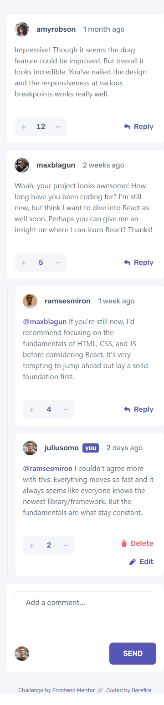
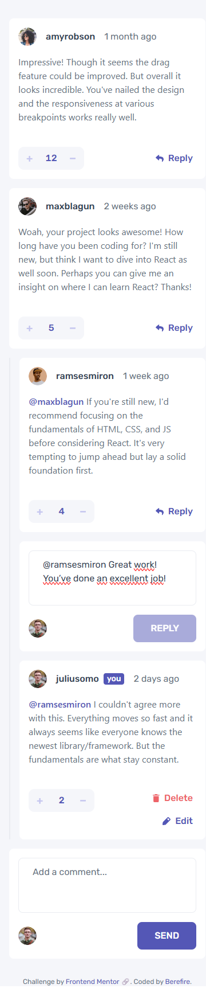
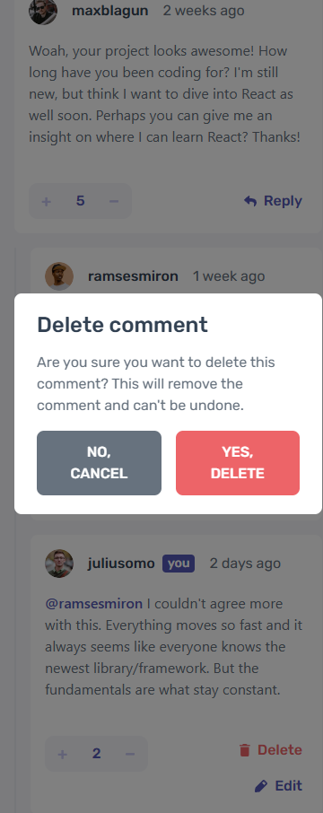
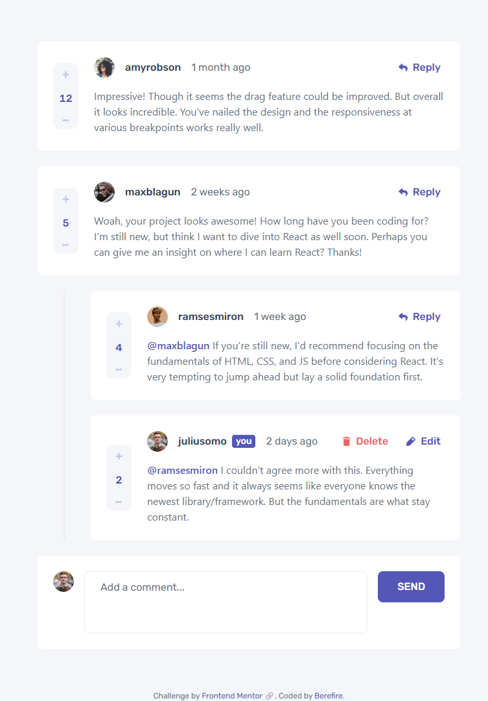
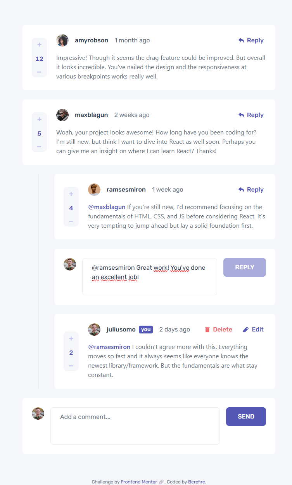
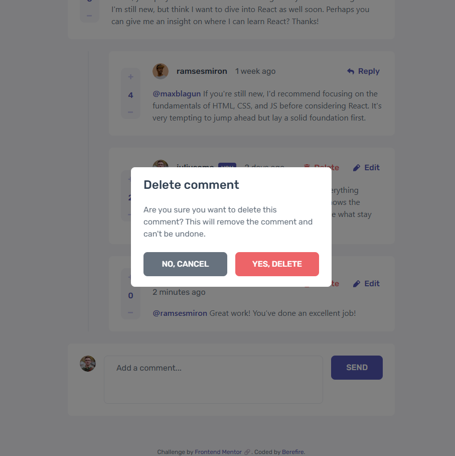
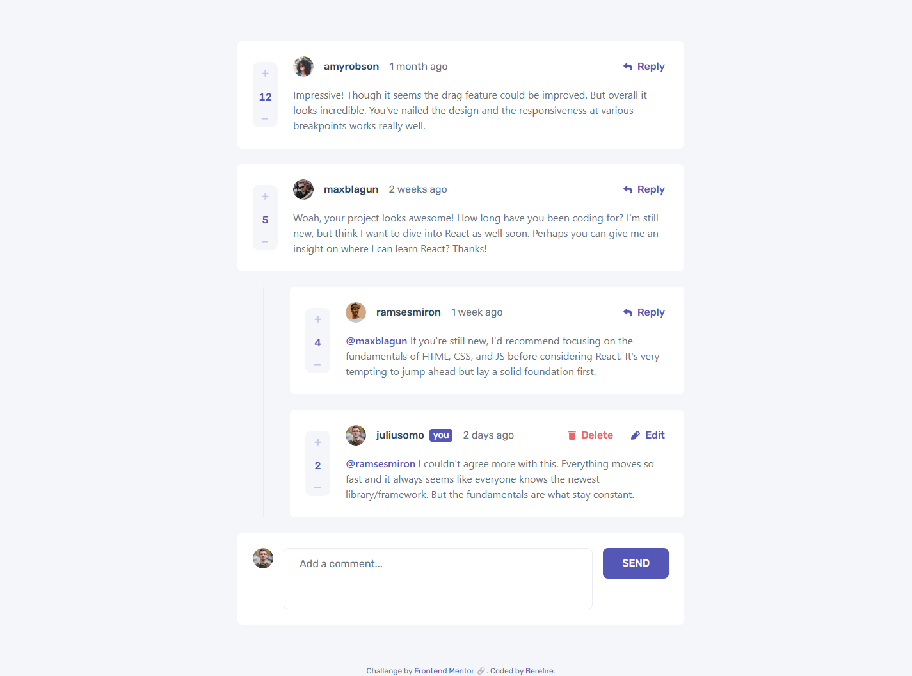
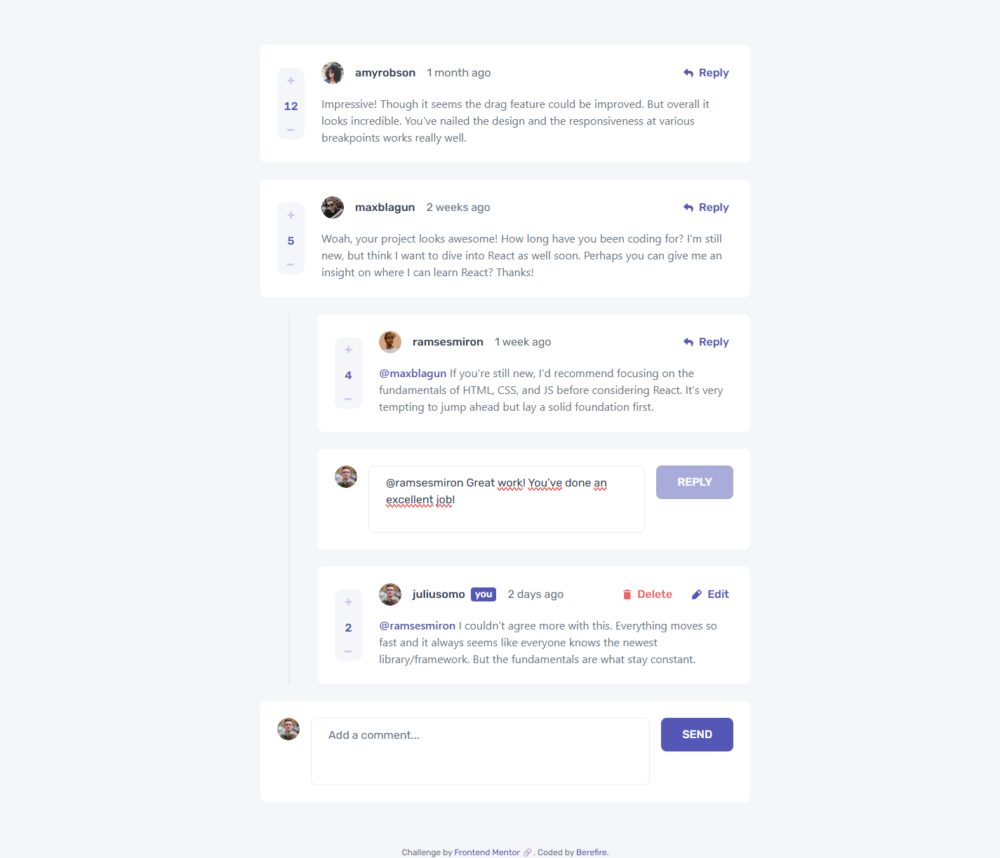
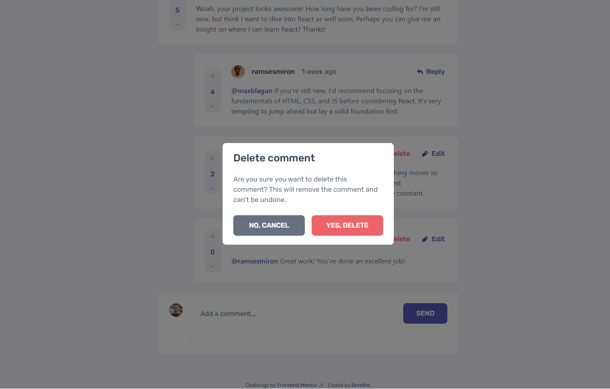

# Frontend Mentor - Interactive comments section solution


[](https://www.frontendmentor.io/)


This is a solution to the [Interactive comments section challenge on Frontend Mentor](https://www.frontendmentor.io/challenges/interactive-comments-section-iG1RugEG9). Frontend Mentor challenges help you improve your coding skills by building realistic projects.

## Table of contents

- [Overview](#overview)
  - [The challenge](#the-challenge)
  - [Screenshot](#screenshot)
  - [Links](#links)
- [My process](#️my-process)
  - [Built with](#built-with)
  - [What I learned](#what-i-learned)
  - [Continued development](#continued-development)
  - [Useful resources](#useful-resources)
  - [AI Collaboration](#ai-collaboration)
- [Author](#author)
- [Acknowledgments](#acknowledgments)

## 📖Overview

### The challenge

Users should be able to:

- View the optimal layout for the app depending on their device's screen size
- See hover states for all interactive elements on the page
- Create, Read, Update, and Delete comments and replies
- Upvote and downvote comments
- **Bonus**: If you're building a purely front-end project, use `localStorage` to save the current state in the browser that persists when the browser is refreshed.
- **Bonus**: Instead of using the `createdAt` strings from the `data.json` file, try using timestamps and dynamically track the time since the comment or reply was posted.

### 📸Screenshot

#### Mobile

| _Comments_ | _Reply & Edit_ | _Delete modal_ |
| ------ | ------ | -------- |
|  |  |  |

#### Tablet

| _Comments_ | _Reply & Edit_ | _Delete modal_ |
| ------ | ------ | -------- |
|  |  |  |

#### Desktop

| _Comments_ | _Reply & Edit_ | _Delete modal_ |
| ------ | ------ | -------- |
|  |  |  |

---

### 🔗Links

- Solution URL: [https://www.frontendmentor.io/solutions/accessible-comments-section-with-react-tailwind-v4-and-full-test-suit-dMRiacpwl9](https://www.frontendmentor.io/solutions/accessible-comments-section-with-react-tailwind-v4-and-full-test-suit-dMRiacpwl9)
- Live Site URL: [https://berefire.github.io/interactive-comments-section/](https://berefire.github.io/interactive-comments-section/)

## ⚙️My process

### Built with

- [React](https://react.dev/) - JS library for building the UI as small, composable components
- [Vite](https://vitejs.dev/) - build tool and dev server
- [Tailwind CSS v4](https://tailwindcss.com/) - utility-first styling, with CSS Grid `grid-template-areas` for the responsive comment layout
- [Storybook](https://storybook.js.org/) - for developing and testing every component in isolation, with `play` functions as interaction tests
- [Vitest](https://vitest.dev/) + [React Testing Library](https://testing-library.com/docs/react-testing-library/intro/) - unit tests for the reducer and helpers, and integration tests for the main user flows
- `useReducer` - for all comment data, with a pure reducer and small immutable helpers for the nested replies
- `useState` - for UI-only state (which reply form, edit form, or delete modal is open)
- The native `<dialog>` element - for the delete confirmation, with built-in focus trap and Escape handling
- `Intl.RelativeTimeFormat` - for "2 days ago"-style timestamps
- `localStorage` - to persist comments across page refreshes, using `useReducer`'s lazy-init argument
- Conventional Commits for commit message structure

---

### 💡What I learned

**Store raw data, format it in the UI.** New comments save an ISO date (`new Date().toISOString()`), and the "2 days ago" text is calculated at render time with `Intl.RelativeTimeFormat`. If I had stored "just now" directly, it would never change. A small `useNow` hook with `setInterval` re-renders the timestamps every minute.

**Nested data must be updated without mutating it.** Replies live inside each comment's `replies` array, so I wrote small helpers (`updateComment`, `removeComment`, `findThreadId`) that always return new arrays and objects. In the tests, a `deepFreeze` helper makes any accidental mutation throw an error immediately:

```js
const initialState = deepFreeze(structuredClone(data));
```

**One HTML structure, two layouts, with `grid-template-areas`.** The score counter is at the bottom on mobile and on the left on desktop, but the HTML order stays the same (which is also better for screen readers and keyboard navigation). In Tailwind arbitrary values, `_` replaces spaces, because a space would split the value into separate classes:

```js
"[grid-template-areas:'header_header'_'content_content'_'score_actions']"
```

**`grid-area` only works on direct children of the grid.** My `Avatar` component passed its `className` to the inner ``, but the grid item was the outer `<picture>`, so the avatar ignored its grid area until I wrapped it in a `<div>`.

**Tailwind's Preflight resets things I didn't expect.** A `<dialog>` is centered by the browser with `margin: auto`, but Preflight sets every margin to `0`, so the modal appeared in the top-left corner until I added `m-auto`. In the same way, `border-grey-100` alone shows nothing: it only sets the color, and the `border` class is needed for the width.

**`aria-disabled` is often better than `disabled`.** When the score reaches 0, the downvote button looks disabled, but with `disabled` a keyboard user would lose the focus (it jumps to `<body>`). With `aria-disabled="true"`, the button stays focusable and screen readers announce it as unavailable.

**Simulated keyboard events don't trigger native browser behavior.** `userEvent.keyboard("{Escape}")` didn't close the `<dialog>` in my tests, because events created by JavaScript are "untrusted" and the browser doesn't run its default actions for them. The test now dispatches the native `cancel` event directly. In contrast, Escape in my own `onKeyDown` handler works with `userEvent`, because it's a normal JavaScript listener.

**Each test must start clean.** Without Vitest's `globals: true`, React Testing Library doesn't clean up the DOM automatically, so a second test found two "Upvote" buttons. Adding `cleanup()` in `afterEach`, and `localStorage.clear()` in `beforeEach` once the app persisted data, made every test independent.

**Elements that appear later need `findBy…`, not `getBy…`.** The delete modal opens in a `useEffect`, so `getByRole` sometimes ran before the dialog was visible. `findByRole` (and `waitFor`) retry until the element appears.

**Product thinking.** I first implemented a “locked” vote (remove your vote before voting the other way), then compared it with how YouTube, Facebook, and Reddit handle voting. I switched to direct switching, the more common pattern, and kept the Frontend Mentor visual design by reusing its hover color for the active vote state.

---

### 🚀Continued development

- **Turn it into a full-stack app** - a Node.js + Express API with PostgreSQL, where the reducer actions become REST endpoints and replies use a `parent_id` column instead of nested arrays.
- **CI with GitHub Actions** - run the unit and Storybook tests on every push.

---

### 📚Useful resources

- [React docs - useReducer](https://react.dev/reference/react/useReducer) - Explained the reducer pattern and the lazy-initialization third argument used for `localStorage`.
- [React docs - You Might Not Need an Effect](https://react.dev/learn/you-might-not-need-an-effect) - Helped me decide when `useEffect` is the right tool (syncing with storage, timers, and the dialog API) and when it isn't (counting votes).
- [MDN - The Dialog element](https://developer.mozilla.org/en-US/docs/Web/HTML/Element/dialog) - Reference for `showModal()`, `close()`, and the `cancel` event.
- [MDN - Intl.RelativeTimeFormat](https://developer.mozilla.org/en-US/docs/Web/JavaScript/Reference/Global_Objects/Intl/RelativeTimeFormat) - Used for the relative timestamps.
- [Testing Library - About Queries](https://testing-library.com/docs/queries/about) - The difference between `getBy`, `queryBy`, and `findBy`.
- [Vitest - Test Projects](https://vitest.dev/guide/projects) - How to run unit tests (jsdom) and Storybook tests (browser) side by side.

---

### 🤖AI Collaboration

I used Claude as a pair-programming partner. I wrote and applied the code myself, and Claude explained concepts, reviewed my components for accessibility and best practices, debugged errors with me, and proposed code when I asked directly (for example, the first version of the reducer and its tests, which I then reviewed, split into files, and adapted).

- **What worked well:** pasting the full error message, not only the line of code, made debugging much faster. The real cause was usually in the message itself (for example, "Found multiple elements" or "Executable doesn't exist").
- **What didn't work as well at first:** some test failures pointed to the wrong line because of source maps, which was confusing until we checked the test name instead. Claude also made a small mistake in one story (using `expect` from the `play` arguments instead of importing it), which ESLint caught right away.

---

## 👤Author

- Frontend Mentor - [@berefire](https://www.frontendmentor.io/profile/berefire)
- GitHub - [@berefire](https://github.com/berefire)

---

## 🙏Acknowledgments

Thanks to Frontend Mentor for the challenge brief, and to Claude for the pair-programming support and code reviews.
